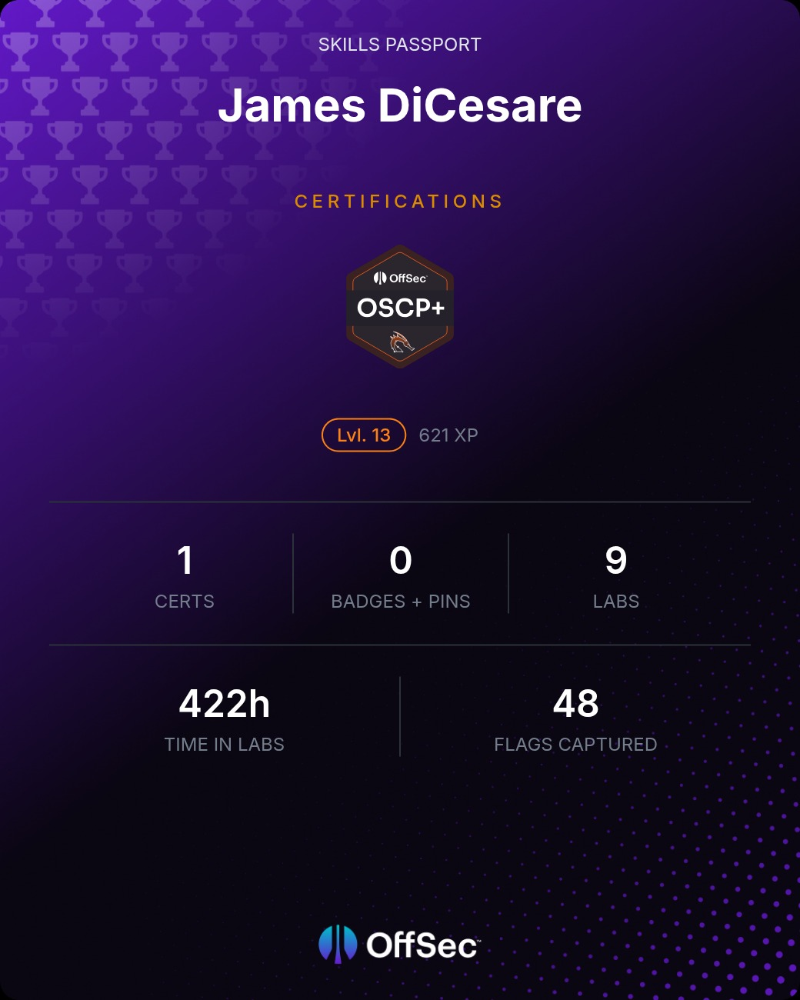

# 💫 About Me:
I'm a veteran and hacker with a background in building, maintaining, securing, and breaking information systems. I have hands-on experience writing software, building and securing cloud infrastructure, and performing vulnerability discovery, testing, and remediation validation. My rich technical background has increased efficiency, lowered risk, and ensured the integrity of businesses and their products.

## 🌐 Socials:
        

## 💰 You can help me by Donating
 

---

# 💻 Tech Stack:
                                   

# 📊 GitHub Stats:
 
 

---

  
<!-- Proudly created with GPRM ( https://gprm.itsvg.in ) -->
